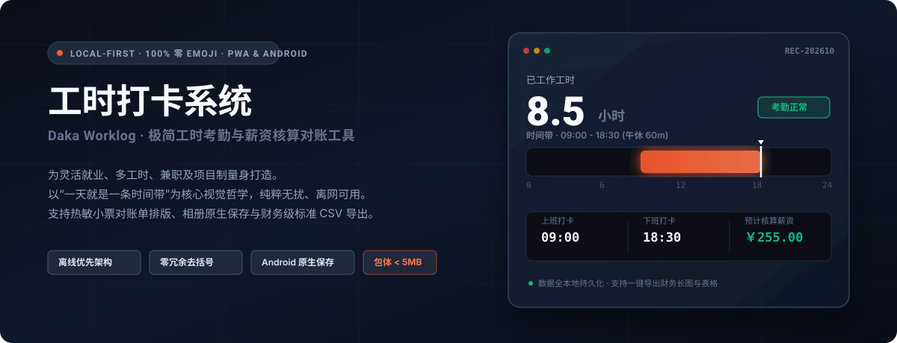
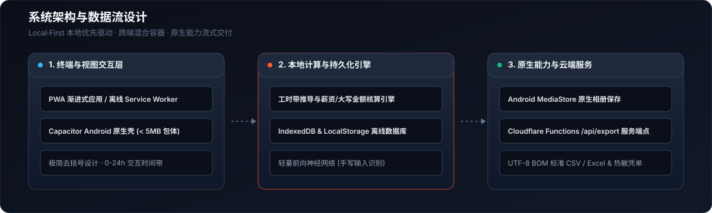

# 工时打卡 (Daka Worklog)

<p align="center">
  
</p>

<p align="center">
  <a href="#核心特性"></a>
  <a href="#架构设计"></a>
  <a href="#移动端支持"></a>
  <a href="#云端部署"></a>
  <a href="./LICENSE"></a>
</p>

---

## 项目简介

**工时打卡 (Daka Worklog)** 是一款专为兼职、灵活就业、工程外包与多工时项目制人员打造的**极简、高保真、本地优先 (Local-First)** 工时考勤与薪资对账结算系统。

区别于传统企业考勤软件的繁琐定位、强制社交和臃肿权限，工时打卡始终贯彻**“单手操作、几秒完成、纯粹无扰”**的产品哲学。所有打卡记录默认存储于本地设备，支持 PWA 离网运行与原生 Android 混合打包，并提供热敏小票式凭单排版、相册原生保存以及标准财务级对账单导出。

---

## 核心特性

- **时间带可视化 (“一天就是一条时间带”)**
  摒弃生硬的表格和复杂统计图，以一条直观的 0–24 点横向时间轨呈现全天工时。橙色时段标记实际工作时间，支持午休时长精准剔除，直观掌握工时跨度与缺卡状态。
- **全端严守 100% 零 Emoji 工业风**
  全系统所有页面与通知严禁使用任何彩色表情符号，文案精炼干脆，采用经典收据凭单排版风格，呈现严谨、专业的财务级对账视觉。
- **多版式核算导出与原生保存**
  - **热敏小票 / 凭单排版**：内置多套经典对账版式，一键生成对账长图。
  - **Android 相册原生写入**：通过定制 `FileExportPlugin`，支持利用 Android `MediaStore` 真实保存长图至系统相册，并在图库即时可见。
  - **标准 CSV / Excel 表格**：内置 UTF-8 BOM 编码导出，自动防护 CSV 公式注入，支持系统原生分享面板。
- **智能薪资与大写金额引擎**
  输入时薪与标准日工时，自动核算应发总额、出勤天数与缺勤缺卡工时，并自动生成符合财务记账规范的汉字大写金额（如“柒佰柒拾柒元整”）。
- **极度克制与安全隐私**
  无账号追踪、无多余后台常驻。标准 Android Debug 安装包体积严格控制在 **4MB ~ 5MB**，极速响应，不占内存。

---

## 架构设计

<p align="center">
  
</p>

1. **终端与呈现层**：基于原生纯粹 Web 技术构建，搭配 Service Worker 离线缓存策略；结合 Capacitor 混合技术封装为轻量 Android 原生 App。
2. **核心逻辑层**：
   - 0–24 小时时间带线性映射引擎
   - 薪资与工时智能计算器（内置大写金额转换）
   - 轻量前向手写神经网络（用于手写补卡识别）
   - 本地持久化层：LocalStorage + 记录级 `updatedAt` + 删除墓碑（tombstones），支持后续多端合并
3. **原生能力与云端支持**：
   - **Android 原生层**：原生 Java 插件，桥接 `MediaStore`、`FileProvider` 与 Android 系统分享面板。
   - **服务端支持（默认关闭，按需开启）**：Cloudflare Pages 静态边缘托管 + Pages Functions (`/api/sync`) 可选同步端点。所有云功能均由服务端环境变量显式开启，默认不发起任何上云请求。

---

## 快速上手

### 1. 本地网页运行

```bash
# 克隆仓库
git clone https://github.com/your-username/daka-worklog.git
cd daka-worklog

# 安装依赖
npm ci

# 生成运行时静态目录 www/
npm run build:web

# 启动本地静态服务
npm run dev
```
浏览器访问 `http://localhost:5173` 即可开始使用。

### 2. 自动化测试与代码规范检查

本项目拥有严格的代码与界面规范门禁：

```bash
# 单元测试 + 薪资/导出回归测试
npm test

# 全局扫描代码与界面，确保 100% 绝对零 Emoji 违规
npm run check:emoji

# 检查 Haptic / 导出器 / DOM id 等引用是否一致
npm run check:refs

# 检查版本号、缓存名、Gradle 与 APK 哈希是否一致
npm run check:versions
```

### 3. Android 原生应用构建

本项目采用 Capacitor 进行 Android 容器封装，构建要求：JDK 21 与 Android SDK。

```bash
# 生成 www/、同步 Web 资源并编译 Debug APK
npm run build:apk
```

`build:apk` 会先执行 `build:web`，再执行 `npx cap sync android` 与 Gradle 构建。构建产物位于 `android/app/build/outputs/apk/debug/app-debug.apk`，发布前请归档到 `release/daka-<version>-android.apk` 与 `release/daka-latest.apk`。

> **构建规范提醒**：请确保 APK 安装包体积稳定在 4MB ~ 5MB 区间。严禁在 Web 目录放置二进制产物，避免资源递归嵌套。

### 4. Cloudflare Pages 部署

```bash
# 1. 生成只包含运行时文件、Functions、安全头与安装包的 .deploy/
npm run build:site

# 2. 部署 .deploy/（不要直接部署仓库根目录）
npx wrangler pages deploy .deploy --project-name daka
```

`.deploy/` 由 `scripts/build-site.mjs` 生成，只包含运行时静态文件、`_headers`、`_routes.json` 与安装包；Pages Functions 由 Wrangler 从项目根目录 `functions/` 读取。构建脚本会自动排除 `design/`、`android/`、`verify_*.js`、`tmp_artifacts/` 等非运行时文件，并校验 APK 哈希与单文件 25MiB 上限。

#### 云端同步（可选）

云端同步默认关闭。需要启用时：

1. 在 Cloudflare D1 创建数据库，并在 Pages 项目中绑定为 `DB`。
2. 执行 `schema.sql`；已有旧库请执行 `migrations/0002_add_deleted_at.sql`。
3. 在 Pages 环境变量中设置 `SYNC_ENABLED=1`，并按需设置 `ALLOWED_ORIGINS`。
4. 当前客户端同步入口默认隐藏且 `syncEnabled=false`；完成鉴权与 UI 后再开放。

`/api/webdav`、`/api/export`、`/api/notify` 默认返回 404，只有显式设置对应 `*_ENABLED=1` 且配置密钥后才启用。

### 5. 版本发布

```bash
# 1. 递增 patch 版本并同步 package.json / app.js / sw.js / Gradle / index.html / version.json
npm run version:bump

# 2. 生成 www/ 并构建 APK
npm run build:web
npm run build:apk

# 3. APK 构建完成后，用同一版本号重新执行以写入 apkSha256
npm run version:bump -- --version 1.0.10

# 4. 重新生成 www/，让 www/version.json 带上哈希，再生成 .deploy/
npm run build:web
npm run build:site
```

`build-site.mjs` 会校验 `version.json.apkSha256` 与 `release/` 中的 APK 一致；不一致时构建失败，避免发布未校验的安装包。

---

## 核心设计规范 (DESIGN TOKENS)

依照项目 [design/DESIGN.md](./design/DESIGN.md) 约定：

| Token | 颜色值 | 界面语义与用途 |
| :--- | :--- | :--- |
| `--ink` | `#141414` | 主文字、大数字展示、主按钮底色、「现在」游标竖线 |
| `--accent` | `#FF5B2E` | 工作时段高光条、缺卡提醒、当前导航标签指示点 |
| `--track` | `#F1F1F1` | 0-24h 时间带轨道底色、已完成按钮底色 |
| `--mute` | `#777777` | 日期标签、单位后缀、次要提示文字 |
| `--line` | `#EEEEEE` | 分割线与区块分隔边框 |
| `--bg` | `#FFFFFF` | 页面基础底色 |

---

## 开源协议

本项目基于 [MIT License](./LICENSE) 协议开源。欢迎提交 Issue 或 Pull Request 共同改进！
